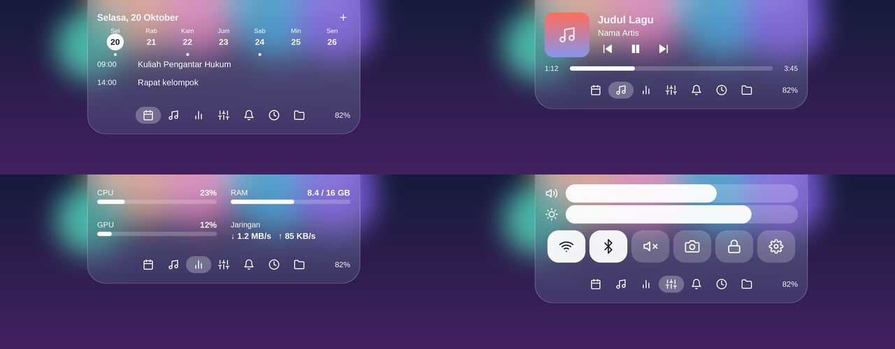
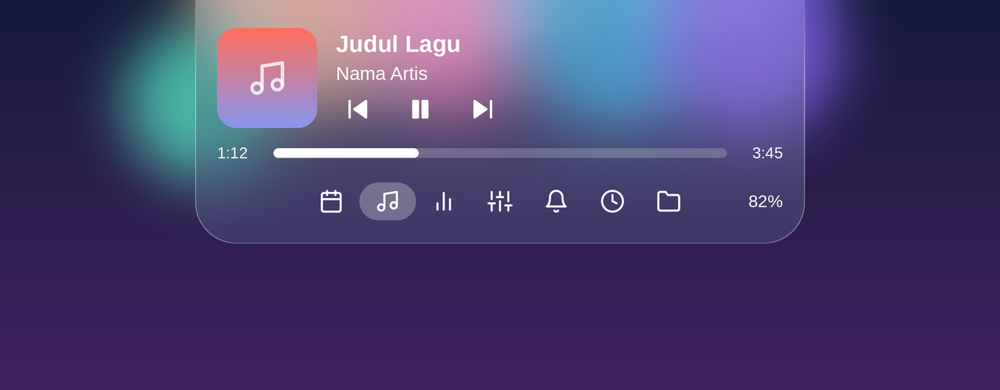
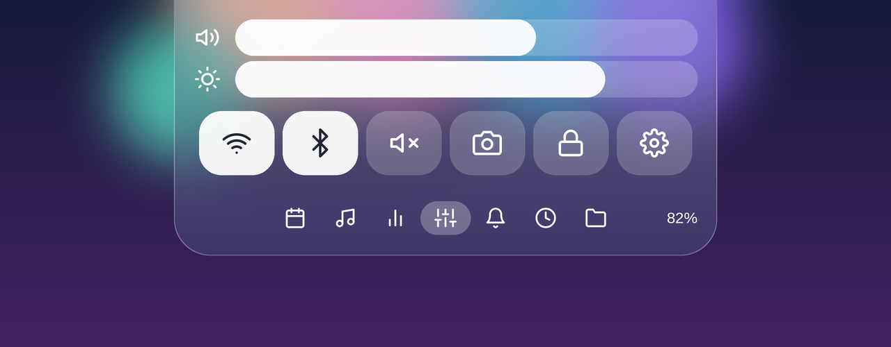

<div align="center">

# Dynamic Island untuk Windows

**Dynamic Island ala iOS di desktop Windows Anda.**
Tampilan kaca buram (frosted glass), animasi pegas yang halus, berisi kalender, pemutar media, statistik sistem, kontrol cepat, dan lainnya dalam satu pil di atas layar.

[**⬇️ Unduh untuk Windows**](https://github.com/USERNAME/REPO/releases/latest/download/DynamicIsland.exe)
&nbsp;·&nbsp;
[Semua rilis](https://github.com/USERNAME/REPO/releases)
&nbsp;·&nbsp;
[English](README.md)

<br>



</div>

---

## Tampilan

<table>
  <tr>
    <td align="center" width="50%">
      <br>
      <b>Kalender &amp; event</b><br>
      <sub>Tampilan default saat kursor masuk ke island</sub>
    </td>
    <td align="center" width="50%">
      <br>
      <b>Pemutar media</b><br>
      <sub>Spotify, YouTube di browser, dan lainnya</sub>
    </td>
  </tr>
  <tr>
    <td align="center">
      <br>
      <b>Statistik sistem</b><br>
      <sub>CPU, RAM, GPU, dan kecepatan jaringan</sub>
    </td>
    <td align="center">
      <br>
      <b>Pusat kontrol</b><br>
      <sub>Volume, kecerahan, Wi-Fi, Bluetooth, dan pintasan</sub>
    </td>
  </tr>
  <tr>
    <td align="center">
      <br>
      <b>Tampilan kecil</b><br>
      <sub>Pil kecil yang tidak mengganggu</sub>
    </td>
    <td align="center">
      <br>
      <b>Toast langsung</b><br>
      <sub>Volume, baterai, Caps Lock, timer, dan lainnya</sub>
    </td>
  </tr>
</table>

<div align="center">
  <br>
  <sub>Indikator Caps Lock</sub>
</div>

---

## Unduh

**[Unduh DynamicIsland.exe (versi terbaru)](https://github.com/USERNAME/REPO/releases/latest/download/DynamicIsland.exe)**

Tidak perlu instalasi: unduh, lalu jalankan file-nya.

> Windows SmartScreen mungkin menampilkan peringatan "Windows protected your PC" karena aplikasi ini belum ditandatangani.
> Klik **More info → Run anyway**.

## Fitur

- **Kalender & event**: kalender bulanan dan daftar event per hari. Event disimpan lokal, dan hari libur nasional bertanggal tetap sudah bawaan.
- **Pemutar media**: judul, cover, putar/jeda/lanjut, dan progress yang bisa digeser untuk media yang sedang diputar (Spotify, YouTube di browser, dll.).
- **Statistik sistem**: CPU, RAM, GPU, kecepatan jaringan, nama Wi-Fi yang tersambung, dan total pemakaian datanya selama 30 hari terakhir.
- **Pusat kontrol**: volume, kecerahan, Wi-Fi, Bluetooth, mute, screenshot, kunci layar, dan Pengaturan Windows.
- **Notifikasi**, **timer**, dan **shelf file** (seret file ke island, seret keluar kapan saja).
- **Baterai Bluetooth**: lihat level baterai headset saat terhubung.
- **Indikator unduhan**: garis aktivitas yang bergerak dan kecepatan saat unduhan browser berjalan, plus toast saat selesai.
- **Toast** untuk volume, baterai laptop, Caps Lock, dan timer selesai.
- **Sembunyi otomatis**: island menyelinap ke atas saat tertutup jendela. Gerakkan kursor ke tepi atas untuk memunculkannya.
- Latar kaca buram dengan ikon yang membulat dan lembut.

## Persyaratan

| | |
|---|---|
| **Sistem operasi** | Windows 10 versi 2004 (build 19041) atau lebih baru, termasuk Windows 11 |
| **Arsitektur** | 64-bit (x64) |
| **.NET** | Tidak perlu: file rilis sudah menyertakan runtime |
| **Layar** | Island diletakkan di tengah atas layar utama |

Catatan per fitur:

- **Kecerahan layar** hanya tersedia di laptop / layar internal (lewat WMI).
- **Baterai Bluetooth** hanya tampil jika perangkatnya melaporkan baterai ke Windows.
  Cek di *Settings → Bluetooth & devices*: jika di sana tidak tampil, di sini juga tidak.
- **Notifikasi**: Windows akan meminta izin saat halaman notifikasi dibuka pertama kali.
- **GPU** butuh pencacah kinerja "GPU Engine" (Windows 10 1709+ dengan driver WDDM 2.0+).
- **Data Wi-Fi** memakai statistik "Penggunaan data" Windows, yang hanya menyimpan 30 hari terakhir.
- **Indikator unduhan** memantau folder *Downloads* untuk file sementara browser (`.crdownload`, `.part`, dll.).
  Browser tidak memberi tahu ukuran total ke Windows, jadi yang tampil adalah aktivitas dan kecepatan, bukan persentase.

## Cara pakai

- Arahkan kursor ke island untuk membuka kalender dan event hari ini.
- **Scroll** (mouse/touchpad) untuk berpindah halaman, atau klik ikon tab di bawah.
- Klik tanggal untuk melihat event-nya. Tekan **+** untuk menambah event, misalnya `14:00 Rapat tim`, lalu Enter.
- **Klik kanan** island untuk *Mulai otomatis dengan Windows* dan *Keluar*.

Event tersimpan di `%AppData%\DynamicIsland\events.json`.

## Privasi

Semua berjalan lokal, tidak ada data yang dikirim ke internet.
Aplikasi memasang *keyboard hook* hanya untuk mendeteksi tombol **Caps Lock**; tombol lain tidak dibaca atau disimpan.
Karena hook ini, sebagian antivirus bisa memberi peringatan palsu (false positive).

## Build dari source

Butuh [.NET 8 SDK](https://dotnet.microsoft.com/download/dotnet/8.0) dan Windows.

```powershell
git clone https://github.com/USERNAME/REPO.git
cd REPO
dotnet run -c Release
```

Membuat satu file `.exe` mandiri:

```powershell
dotnet publish DynamicIsland.csproj -c Release -r win-x64 --self-contained true `
  -p:PublishSingleFile=true -p:IncludeNativeLibrariesForSelfExtract=true -p:EnableCompressionInSingleFile=true -o publish
```

Hasilnya ada di `publish\DynamicIsland.exe`.

## Merilis versi baru

Push tag versi, lalu GitHub Actions otomatis build dan memasang `DynamicIsland.exe` ke halaman Releases:

```powershell
git tag v1.0.0
git push origin v1.0.0
```

## Lisensi

Tentukan lisensi Anda di sini (mis. MIT).
