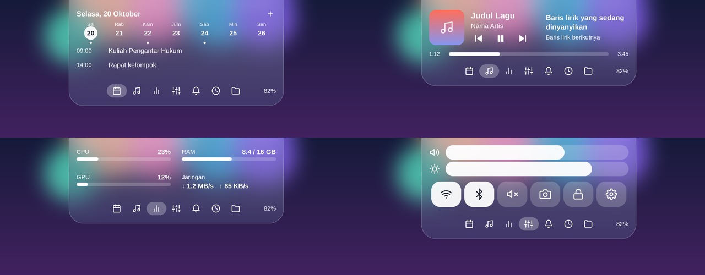
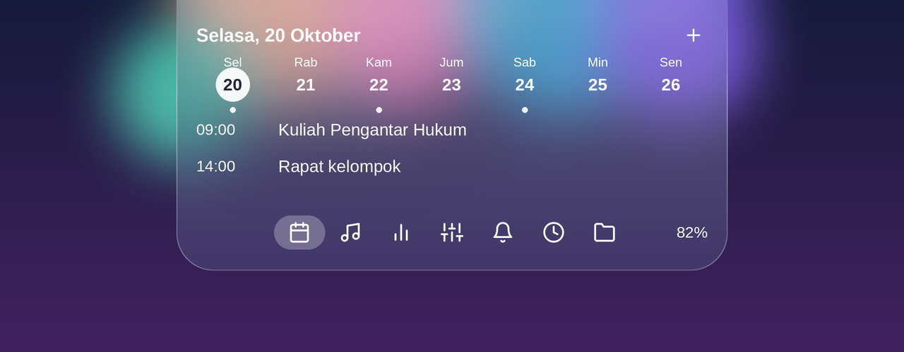
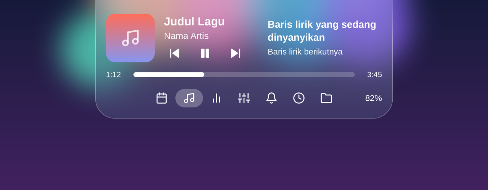
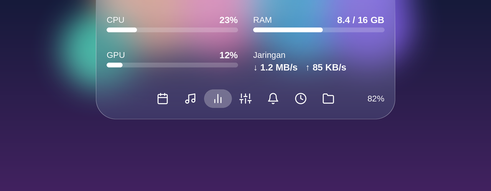

# Dynamic Island for Windows

**English** | [Bahasa Indonesia](README.id.md)

An iOS-style **Dynamic Island** for Windows 10 and 11. A frosted-glass pill sits at the top-center of your screen, expands with springy animation when you hover over it, and gives you a calendar, media controls, system stats, a control center and more — without opening a single window.

<!-- TODO: replace the images below with real screenshots of your app -->


## Download

[](https://github.com/LitRHap/dynamic-island_windows/releases/)

| Version | Link | Needs |
|---|---|---|
| **Standalone** (recommended) | [DynamicIsland-win-x64-standalone.zip](https://github.com/USERNAME/REPO-NAME/releases/latest/download/DynamicIsland-win-x64-standalone.zip) | Nothing else, just unzip and run (larger file) |
| **Lightweight** | [DynamicIsland-win-x64.zip](https://github.com/USERNAME/REPO-NAME/releases/latest/download/DynamicIsland-win-x64.zip) | [.NET 8 Desktop Runtime (x64)](https://dotnet.microsoft.com/download/dotnet/8.0) |

All versions: [Releases page](https://github.com/USERNAME/REPO-NAME/releases).

**Install:**

1. Download a zip above and extract it to any folder (e.g. `C:\Apps\DynamicIsland`).
2. Run `DynamicIsland.exe`. The island appears at the top-center of your screen.
3. *(Optional)* Right-click the island and choose **Start with Windows**.

> **"Windows protected your PC" (SmartScreen)?** The app is not code-signed. Click **More info → Run anyway**. The full source code is in this repository.

## Features

- **Frosted glass** – the island blurs whatever is behind it, with a soft tint and glass rim. Flat top flush with the screen edge, rounded bottom.
- **iOS-like motion** – spring-based animation that can be interrupted smoothly (move in and out and it reverses without restarting).
- **Hover to expand, scroll to switch pages** – use the mouse wheel or touchpad to move between pages, or click the icons at the bottom.
- **Soft rounded icons** – all icons are vector shapes with round caps and joins, no sharp corners.

### Pages

| Page | What it does |
|---|---|
| **Calendar & events** (default) | Date, a 7-day strip and your upcoming events |
| **Media** | Now playing from Spotify, browsers and other players: cover, title, artist, play/pause/skip, seekable progress bar |
| **Performance** | CPU, RAM, GPU and network speed, updated every second |
| **Control Center** | Volume and brightness sliders, Wi-Fi, Bluetooth, mute, screenshot, lock, Settings |
| **Notifications** | Windows notifications (see limitations) or a shortcut to the Notification Center |
| **Timer** | Quick presets (1 / 5 / 10 / 25 min), pause and reset |
| **File shelf** | Drag files onto the island, drag them out again anywhere |

### Live indicators

- Volume change, power plugged/unplugged and low-battery toasts
- **Caps Lock reminder** (works in every app) with a small badge on the pill while it is on
- Timer remaining time on the collapsed pill
- The island **slides away** when a window (e.g. your browser's tab bar) covers its area; move the cursor to the top edge to bring it back






## Requirements

**To run the app**

| | |
|---|---|
| OS | Windows 10 (version 1903 or later) or Windows 11, 64-bit |
| Runtime | None for the *Standalone* download. The *Lightweight* download needs the [.NET 8 Desktop Runtime (x64)](https://dotnet.microsoft.com/download/dotnet/8.0) |
| Permissions | No administrator rights needed |
| Optional hardware | Laptop or internal display (brightness slider), Wi-Fi / Bluetooth adapter (toggles), GPU with Windows performance counters (GPU stats) |

**To build from source**

- [.NET 8 SDK](https://dotnet.microsoft.com/download/dotnet/8.0)
- Visual Studio 2022 (17.8+) with the *.NET desktop development* workload, or VS Code
- Internet on the first build (NuGet packages are restored automatically)

## Build from source

```bash
git clone https://github.com/USERNAME/REPO-NAME.git
cd REPO-NAME
dotnet run
```

Create a standalone build:

```bash
dotnet publish -c Release -r win-x64 --self-contained false
```

The executable ends up in `bin/Release/net8.0-windows10.0.19041.0/win-x64/publish/`.

## Usage

| Action | Result |
|---|---|
| Hover over the pill | Expands (opens on the Calendar page) |
| Mouse wheel / touchpad scroll | Next / previous page |
| Click the icons at the bottom | Jump to a page |
| Drag files onto the island | Opens the file shelf |
| Move cursor to the very top edge | Reveals the island when auto-hidden |
| Right-click the island | Start with Windows, Exit |

## Customize

Constants near the top of `MainWindow.xaml.cs`:

- `GlassA`, `GlassR`, `GlassG`, `GlassB` – glass opacity and tint
- `Jelly` – 0 = calm iOS feel, 1 = wobbly water effect
- `AutoHideWhenCovered` – turn the slide-away behavior on/off
- `CW`, `CH`, `EW`, … – sizes

## How it works

- A fixed-size, per-pixel-transparent WPF window; the island shape is drawn and animated by WPF, so there is no window resizing and no flicker.
- Glass: the area behind the island is captured, downscaled, blurred and color-boosted on the CPU, then clipped to the island shape.
- Spring physics drive the size and position each frame.
- Media via Windows Global System Media Transport Controls, audio via NAudio, Caps Lock via a low-level keyboard hook, GPU stats via Windows performance counters.

## Troubleshooting

- **SmartScreen warning** – see the note in *Download*; the app is unsigned.
- **Antivirus flags the app** – the Caps Lock reminder uses a low-level keyboard hook that only reacts to the Caps Lock key. The code is open for review.
- **Caps Lock reminder does nothing while an "Run as administrator" window is focused** – Windows does not let normal apps see keys typed into elevated windows.
- **The island doesn't show up** – check it isn't auto-hidden behind a maximized window; move the cursor to the very top edge of the screen.

## Known limitations

- **Reading Windows notifications** needs a packaged (MSIX) app. When run unpackaged, the Notifications page falls back to a button that opens the Windows Notification Center.
- The **brightness** slider only appears on laptops / internal displays.
- **GPU** usage uses Windows performance counters and may show `N/A` on some systems.
- Primary monitor only.

## License

[MIT](LICENSE)

<!-- TODO: document any extra features here (e.g. Bluetooth battery, download watcher) -->
